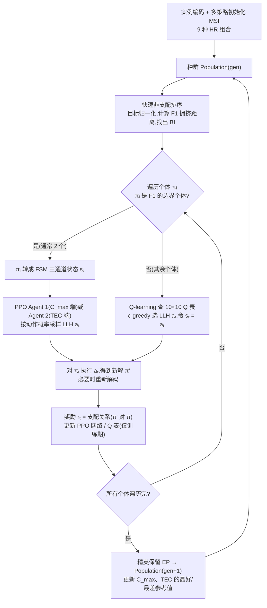
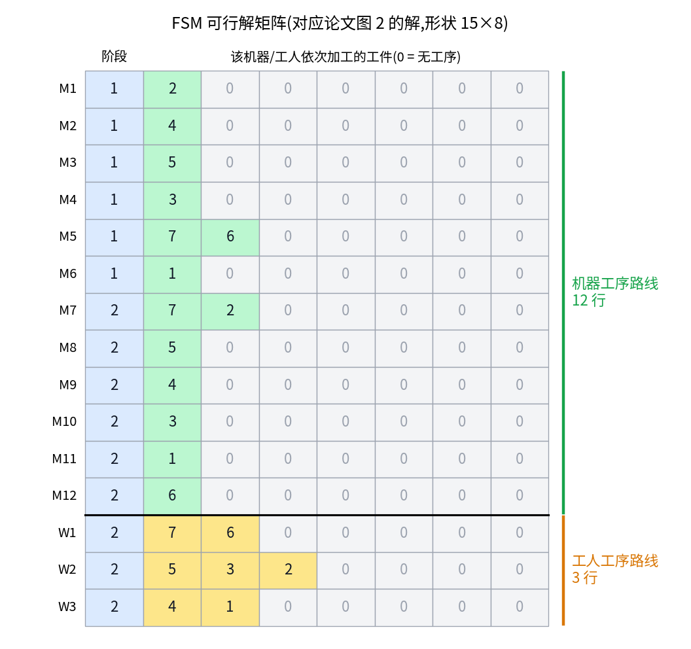
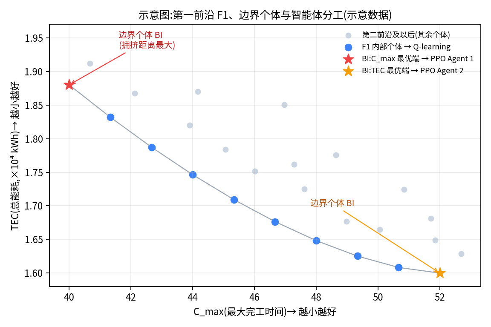
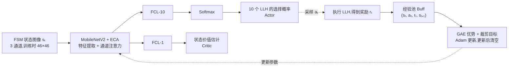
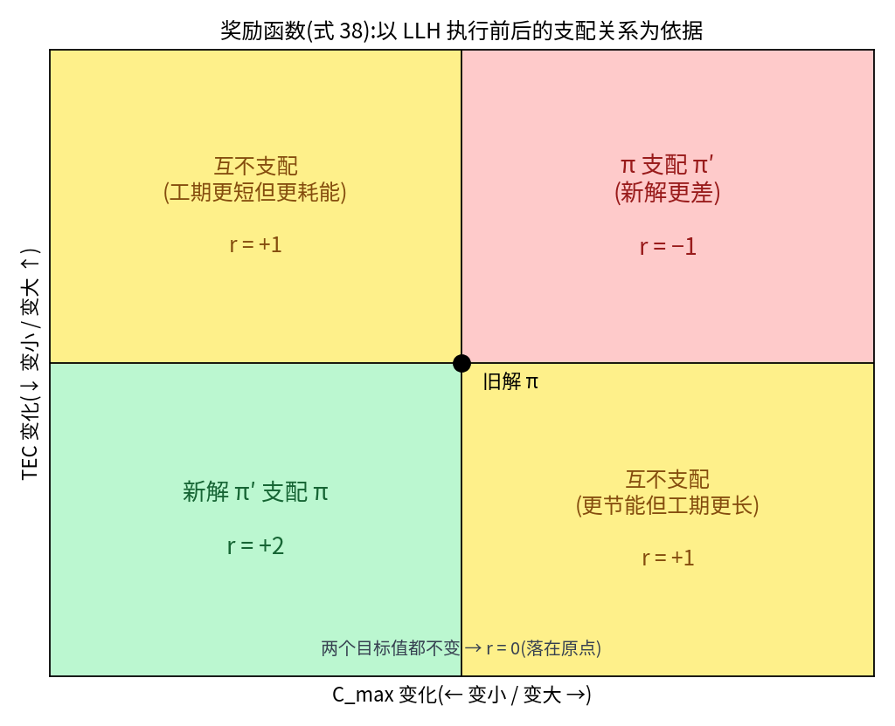
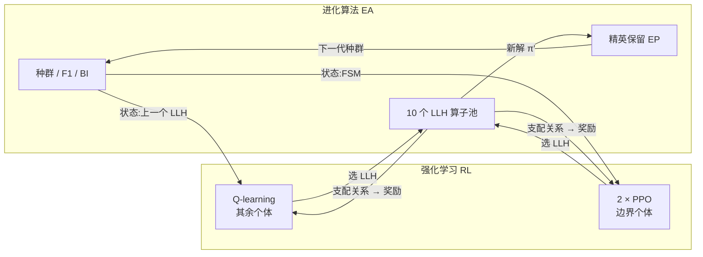
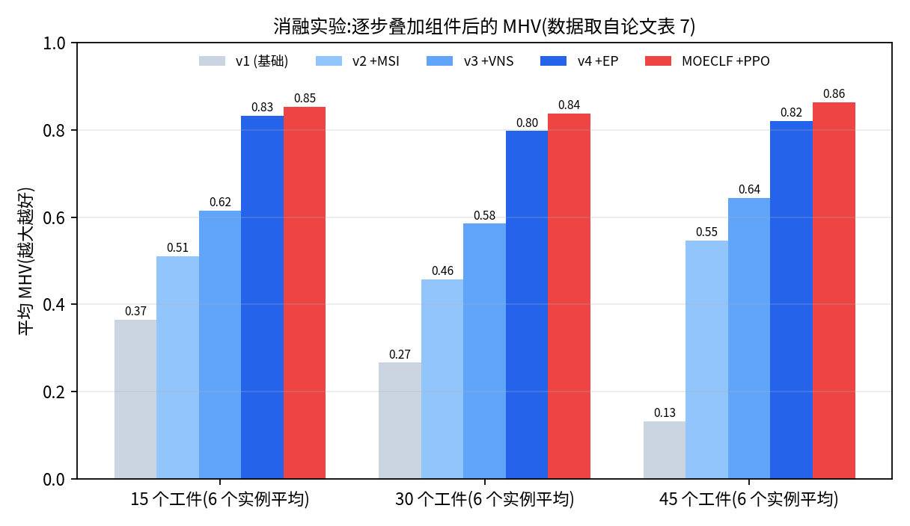
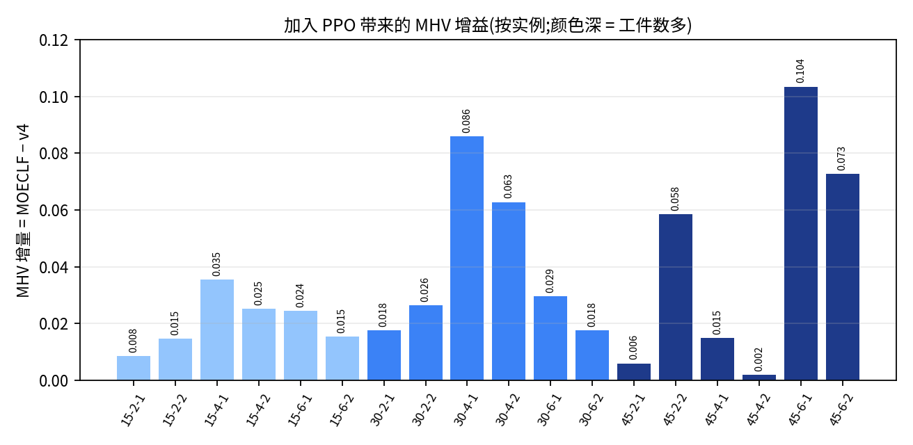

# DRL 增强进化算法(EA)学习笔记

> **以 MOECLF 求解 EHFSP-HMC 为例**
>
> 论文:Wu J., Liu Y., Zhang Y. *Multi-objective evolutionary co-learning framework for energy-efficient hybrid flow-shop scheduling problem with human-machine collaboration*. Swarm and Evolutionary Computation 95 (2025) 101932.
>

---

## 目录

0. [一页纸速览](#0-一页纸速览)
1. [背景:RL 为什么能帮 EA](#1-背景rl-为什么能帮-ea)
2. [问题回顾:EHFSP-HMC](#2-问题回顾ehfsp-hmc)
3. [总体框架：一代进化怎么跑](#3-总体框架一代进化怎么跑)
4. [EA 端的支撑模块](#4-ea-端的支撑模块)
5. [动作空间:10 个 LLH](#5-动作空间10-个-llh)
6. [状态表示:LLH 状态与 FSM](#6-状态表示llh-状态与-fsm)
7. [两类智能体：谁管谁、怎么学](#7-两类智能体谁管谁怎么学)
8. [奖励函数：用支配关系说话](#8-奖励函数用支配关系说话)
9. [训练与测试](#9-训练与测试)
10. [闭环协同：到底怎么"增强"](#10-闭环协同到底怎么增强)
11. [实验证据](#11-实验证据)
12. [批判性阅读：哪些结论要打折扣](#12-批判性阅读哪些结论要打折扣)
13. [复现用伪代码](#13-复现用伪代码)
14. [自测题](#14-自测题)
15. [符号与缩写速查](#15-符号与缩写速查)

---

## 0. 一页纸速览

**一句话**:把进化算法里"对哪个个体、用哪种算子"这个决策，交给强化学习去学。对决定帕累托前沿范围的 **2 个边界个体**,用 **2 个 PPO**(看整个解);对 **其余个体**,用 **1 个 Q-learning**(看上一个算子)。

| 要素 | MOECLF 的设计 |
|---|---|
| 要解的问题 | 带工人疲劳、可调速机器的混合流水车间，双目标：最小化 C_max 与 TEC |
| EA 部分 | 多策略初始化(MSI)+ 10 个 LLH + 精英保留(EP) |
| RL 的角色 | **选算子**(超启发式的控制域),不再依赖固定的交叉率、变异率 |
| 动作 | 10 个 LLH:遗传 3 个 + GVNS 3 个 + LVNS 3 个 + L-Move 1 个 |
| 状态 | Q-learning:上一个用的 LLH;PPO:三通道 FSM 矩阵(路线、加工时间、能耗) |
| 奖励 | 比较同一个体改动前后的支配关系:+2 / +1 / 0 / −1 |
| 网络 | MobileNetV2 + ECA 通道注意力,Actor 输出 10 维概率,Critic 输出 1 个价值 |
| 训练方式 | 在 10 个 45 工件 × 6 阶段实例上学习，测试时冻结策略直接用 |


---

## 1. 背景:RL 为什么能帮 EA

### 1.1 RL 在 EA 中的三种角色

论文分析表 1 后归纳出 RL 的三种角色:

| 角色 | 做什么 | 表 1 中的例子 |
|---|---|---|
| ① 调整 EA 的参数 | 自适应调交叉率、变异率等 | Yao 2024(DQN 调交叉概率);Zhuang 2024(SARSA + DQL 调交叉和变异概率);Wang 2023(Q-learning 调食物源相关参数) |
| ② 选择 EA 的搜索算子 | 在多个算子里挑一个 | Zhang 2024 MRLM、Li 2024 EMTMA、Jiang 2024 QBMA、Zhang 2024 DQN-VNS 等 |
| ③ 构造解 | 把 RL 与问题变量直接对应 | Li 2023 RL-ABC(确定最佳子批方案) |

**本文属于第 ②类**:用 RL 选 LLH。

### 1.2 现有做法的两个缺口

1. **多数 RL 引导的 EA 基于 Q-learning**,而 Q-learning 要把状态离散成表格，处理高维状态很吃力。
2. **深度强化学习(DRL)进入多目标车间调度的研究还很少**,论文把它视为一个值得做的方向。

此外 3.4.1 还批评了常见的"两模块"做法：全局搜索(交叉变异)与局部搜索(VNS)被拆成两个模块，交叉率、变异率仍要手动设定，参数更多。MOECLF 的回应是把遗传算子、GVNS、LVNS 算子 **全部放进同一个 RL 动作空间**。

### 1.3 论文自述的三个目标

(1) 在 HFSP 框架内优化人机资源利用并实现节能调度;(2) 把 DRL 与多目标优化结合，用于解的特征识别和进化状态监测;(3) 用已有实例训练，为没见过的实例提供算子选择策略。

---

## 2. 问题回顾:EHFSP-HMC

| 项目 | 内容 |
|---|---|
| 结构 | I 个工件依次经过 K 个阶段，每阶段有 M_k 台速度不同的并行机；部分阶段为**半自动**(需要工人做准备),其余为**全自动** |
| 目标 | min C_max,min TEC(TEC = CEC + SEC + PEC + IEC) |
| 决策 | 工件顺序、机器分配、工人分配(半自动阶段) |
| 冲突来源 | 机器速度快 → 加工时间 p̂ = p·Σ x/v 缩短，但功率系数 q 变大、PEC 上升 |
| 疲劳 | 工人疲劳会拉长准备时间 t̂(式 26),周期 T_k 到点清零 |
| 难度 | 强 NP-hard;决策彼此耦合，单靠固定算子配比很难兼顾 |

---

## 3. 总体框架：一代进化怎么跑

### 3.1 RL 与 EA 的概念映射(论文图 3)

论文强调"协同进化关系"的建立：把智能体的组成部分与种群的组成部分一一对应。

| RL 概念 | EA 概念 | 含义 |
|---|---|---|
| Episode | Instance | 对一个调度实例完整跑一次进化 |
| State | Solution | 状态是对解的"观察窗口" |
| Action | Operator | 动作 = 选哪个 LLH |
| Reward | Domination | 奖励来自支配关系判断 |
| Batch | Population | 一代个体产生的经验 |
| Epoch | Generations | 迭代代数 |

批大小 B、学习轮数 Ep 与种群规模 Np、代数 Ngen 挂钩:Np × Ngen 决定了总共能产生多少经验样本。

### 3.2 一代进化的流程(对应论文图 4、图 8)



流程中有几个细节:

- **BI 怎么找**:目标值归一化到 [0,1] 后算 F1 的拥挤距离，取拥挤距离最大者，即前沿两端的极端解。
- **F1 只有一个个体时**:把它的 FSM 复制一份，同时交给两个 PPO 智能体(论文 3.5 的 Step 6)。
- **奖励计算与网络、Q 表的更新**只在训练阶段进行，测试阶段省略。
- **四个参考值**(C_max 与 TEC 各自的最好、最差)每代更新，保证下一代拥挤距离计算准确。

---

## 4. EA 端的支撑模块

RL 只负责"选",真正干活的是 EA 这一侧的模块。

### 4.1 三层编码

采用 **基于工件(job-based)编码**:只进化第 1 阶段的工件顺序，后续阶段由规则解码得到。因为还要决定机器和工人，所以做成三层:

| 层 | 内容 | 来源 |
|---|---|---|
| 工件序列 | 阶段 1 的加工顺序 | 随机生成，之后由 LLH 进化 |
| 机器选择 | 每个位置的工件用哪台机器 | 启发规则决定 |
| 工人选择 | 每个位置的工件由哪位工人准备(自动阶段为 ∅) | 启发规则决定 |

### 4.2 多策略初始化(MSI)

机器、工人各有三种选择规则 **HR = {WB, EAT, R}**:

| 规则 | 选谁 | 对应的问题性质 |
|---|---|---|
| WB(工作量均衡) | 累计工作量最小的 | 性质 2:得到兼顾 C_max 与 TEC 的折中解 |
| EAT(最早可用) | 最早空闲的 | 性质 1:压缩等待、缩短工期 |
| R(随机) | 随机 | 保证多样性 |

机器 3 种 × 工人 3 种 = **9 种组合规则**。以 Np = 200 为例，每种组合生成 ⌊200/9⌋ = 22 个个体，共 198 个，剩下 2 个用纯随机规则补齐。

### 4.3 启发式解码(HD)

逐阶段、逐工件地计算开始时间、完工时间、工作量和能耗(论文算法 2–4)。其中算法 3 体现了资源互斥:

- 半自动阶段:S_ik = max(机器可用时间, 工人可用时间, 工件释放时间),工人只占用到准备结束。
- 机器占用到加工结束。

**加速**:首次解码时把累计工作量、累计能耗、工件释放时间存入 **检查表**。LVNS 类算子只改动一个阶段，解码时直接读表恢复前序状态，不必从阶段 1 重算。

### 4.4 父代选择(论文算法 5)

遗传算子需要两个父代。P1 是当前被处理的个体,P2 的选法:

| P1 的情况 | P2 的选法 |
|---|---|
| 不在 F1 | 从 F1 随机选 |
| 在 F1,且 BI 只有 1 个 | 从第二前沿随机选 |
| 在 F1,但不是 BI | 从 BI 中随机选 |
| 本身是 BI | 选另一个 BI |

这样不同层级的个体都能与关键个体交互，同时省掉了锦标赛规模这个参数。

### 4.5 精英保留(EP)

一代遍历结束后，用 EP 配置下一代种群。论文指出，当有多个 r_t = 1 的互不支配新解时,EP 的作用尤其明显。

---

## 5. 动作空间:10 个 LLH

三个问题性质是设计 LLH 的依据:

- 性质 1:机器上的"松弛最早可加工时间" S^s_ik = max(AT_mk, RT_ik)。
- 性质 2:在不考虑资源空闲时，通过工作量均衡(WB)可以近似得到帕累托均衡解。
- 性质 3:当关键工序 OP_l 受机器可用时间限制时，把它换到满足 EAT 与 SPT 的机器上,C_max 一定下降，且新解支配或不被原解支配。

| LLH | 名称 | 族 | 操作 | 解码范围 |
|---|---|---|---|---|
| 1 | 2p-OXO | 遗传 | 两点顺序交叉 | 从阶段 1 全局解码 |
| 2 | 2p-ESM | 遗传 | 切成三段后重排(两点片段交换变异) | 全局 |
| 3 | 2p-OXO-ESM | 遗传 | 先 LLH1 再 LLH2 | 全局 |
| 4 | FL-Swap | GVNS | 交换最先完工工件 J_f 与最后完工工件 J_l 在阶段 1 的位置 | 全局 |
| 5 | FL-Insert | GVNS | 把 J_l 插到 J_f 之后 | 全局 |
| 6 | LR-Reverse | GVNS | 把 J_l 与另一个随机位置之间的片段逆序 | 全局 |
| 7 | MW-Move | LVNS | 把负荷最大机器上的随机工件移到负荷最小机器 | 局部(只改阶段 k) |
| 8 | RA-Swap | LVNS | 交换释放时间最接近的相邻两个工件 | 局部 |
| 9 | SL-Move | LVNS | 随机工件换到最快机器(SPT);已在最快或常规速度机器上则换到最慢机器(LPT) | 局部 |
| 10 | L-Move | 关键工序 | 对 OP_l 按优先级换机器:EAT → EAT+SPT → EAT+LPT,换到与原机器不同为止 | 论文未明说 |

补充说明:

- LLH10 的族归属论文没有明确写出，我把它单列。（推断）它针对关键工序，与"关键路径类"算子同类。
- 解码范围一栏中,"局部"一项由论文关于 LVNS 的说明得出;LLH10 是否局部解码，论文没说。

**LLH1 示例(论文图 6a)**:R₁=1,r₁=2,r₂=5。

```
P1 = 4 [7 3 5 1] 6 2        P2 = 5 2 6 7 1 4 3
把 P1 第 2–5 位片段原位保留;其余空位按 P2 的顺序、跳过已有基因补入(2、6、4)
C1 = 2 [7 3 5 1] 6 4
```

**LLH2 示例(论文图 6b)**:把染色体切成 A | B | C 三段,R₂ 选择重排方式:R₂=1 → A C B,R₂=2 → C B A,R₂=3 → B A C。

---

## 6. 状态表示:LLH 状态与 FSM

### 6.1 第一类状态:LLH 状态(给 Q-learning)

- 状态 = **最近一次执行的 LLH**,共 10 种。
- Q 表是 10 × 10:行是当前状态，列是下一个要选的动作。
- 执行动作后新状态就是刚选的 LLH(图中标 sₜ = aₜ)。

它学到的是"哪个算子之后接哪个算子效果好"。局限：完全不看解长什么样，两个瓶颈完全不同的解，只要上一个算子相同，在它眼里就是同一个状态。

### 6.2 第二类状态：可行解矩阵 FSM(给 PPO)

FSM 把完整调度方案写成矩阵,**形状为 (Σ_k(|M_k| + |W_k|)) × (|I| + 1)**:

- 每一行是一台机器或一位工人的工序路线;
- 第 1 列是阶段编号，后面依次是它处理的工件,0 表示无工序;
- 上半部分是机器行，下半部分是工人行。



*图 1:对应论文图 2 的解(7 个工件、2 个阶段、12 台机器、3 位工人),矩阵为 15 × 8。可对照论文图 5 逐行核对，例如阶段 2 的 M7 行是"7、2",工人 W2 行是"5、3、2"。*

**三个通道**(对应论文图 4 的 Three Channels):

| 通道 | 内容 | 归一化 |
|---|---|---|
| 通道 1 | 路线矩阵本身(阶段号、工件号) | 除以阶段数、工件数，落在 (0, 1] |
| 通道 2 | 加工时间：工人行存 t̂_ik,机器行存 t̂_ik + p̂_ik | 除以目标函数值 |
| 通道 3 | 与之对应的能耗 | 除以目标函数值 |

**尺寸统一**:训练实例取最大规模(45 工件、6 阶段,34 台机器、12 位工人),FSM 为 (34+12) × (1+45) = **46 × 46**。较小的实例可以嵌入这个尺寸，让同一个网络泛化到没见过的实例。

**好处**:不需要手工设计特征，直接用解的序列和问题变量，并把通道 2、3 与优化目标挂钩。

---

## 7. 两类智能体：谁管谁、怎么学

### 7.1 为什么按"个体重要性"分工

- **BI(边界个体)是前沿的"撑杆"**:C_max 最小的一端和 TEC 最小的一端，决定帕累托前沿能延展多远。
- **BI 的质量会扩散**:由 4.4 的父代选择规则,F1 个体交叉时优先选 BI 配对，非 F1 个体交叉时从 F1 里选。
- 论文原话大意:BI 影响 EA 的整体搜索方向，所以设计两个结构相同的 PPO 来管理 BI,其余个体用 Q-learning 保证高效搜索。



*图 2:示意图(示意数据)。红星 = C_max 最优端的 BI,交给 PPO Agent 1;橙星 = TEC 最优端的 BI,交给 PPO Agent 2;其余个体由 Q-learning 负责。*

| | BI(通常 2 个) | 其余个体(约 Np − 2 个) |
|---|---|---|
| 智能体 | 2 个 PPO | 1 个 Q-learning |
| 状态 | 整个解的 FSM 矩阵 | 上一次用的 LLH |
| 看到的信息 | 解的内容(深层特征) | 算子历史(表层信息) |
| 选择方式 | 按网络输出概率采样 | ε-greedy(ε = 0.4) |
| 角色 | 精细开发 | 广泛探索 |

（推断）数据量上的差别也是分工的原因：每代 PPO 最多只处理两个端点个体，经验稀疏，所以把昂贵的深度模型只用在最关键的少数个体上;Q-learning 每代要处理近 200 个个体，一张 10 × 10 的表就够用。

### 7.2 Q-learning 智能体

更新公式(论文式 29):

$$
Q(s_t,a_t)\leftarrow Q(s_t,a_t)+\alpha_q\Big[r_t+\gamma\max_{a\in A}Q(s_{t+1},a)-Q(s_t,a_t)\Big]
$$

动作选择(论文式 30,ε-greedy):

$$
a_t=\begin{cases}\arg\max_{a\in A}Q(s_t,a), & rand_t>\varepsilon\\[2pt] \text{random}, & \text{otherwise}\end{cases}
$$

- ε 是随机探索的概率，调参后取 0.4,即 40% 的时候随机选。
- α_q = 0.15,γ = 0.98(表 5)。

**数值例子**:Q(s,a) = 0.5,r = 2,max Q(s′,·) = 1,则
新 Q = 0.5 + 0.15 × (2 + 0.98 × 1 − 0.5) = 0.5 + 0.15 × 2.48 ≈ **0.872**。

### 7.3 PPO 智能体



**为什么选 MobileNetV2 + PPO(论文给出的理由)**

| 组件 | 理由 |
|---|---|
| MobileNetV2 | 在不少图像任务上精度高，计算量明显低于 ResNet18 等模型，适合在进化过程里反复调用 |
| PPO | 在线策略(on-policy),会动态清空经验池，省内存；按概率分布采样动作，与 Q-learning 的动作执行方式互补；已被用于 JSSP 中 FSM 的识别 |
| ECA | 嵌入 MobileNetV2,自适应决定一维卷积核大小，让网络学各通道的重要性，同时避免降维造成的信息损失 |

**ECA 的核大小**(论文式 31):

$$
k'=\left|\frac{\log_2 C}{\gamma'}+\frac{b}{\gamma'}\right|_{odd},\qquad \gamma'=2,\ b=1
$$

|·|_odd 表示取最近的奇数,C 是网络中间特征图的通道数。例如 C = 512 时,9/2 + 1/2 = 5,k′ = 5。通道权重 ω_i = σ(Σ w^j y^j),其中 σ 是 sigmoid,只在相邻 k′ 个通道内交互。

**PPO 的三项损失**(论文式 34–37)

$$
L_\theta=-\mathbb{E}_t\Big[\min\big(\zeta_t(\theta)A_t,\ \mathrm{clip}(\zeta_t(\theta),1-\epsilon_{clip},1+\epsilon_{clip})A_t\big)\Big],\quad \zeta_t(\theta)=\frac{\pi_\theta(a_t|s_t)}{\pi_{\theta_{old}}(a_t|s_t)}
$$

$$
L_E=-\mathbb{E}\sum_{t=1}^{B}\Big(-\sum_{a\in A}p_{a,t}\log p_{a,t}\Big),\qquad
L_\phi=\mathbb{E}\sum_{t=1}^{B}(\hat v_t-v_t)^2
$$

$$
L_{sum}=C_\theta L_\theta+C_E L_E+C_\phi L_\phi
$$

| 项 | 作用 |
|---|---|
| L_θ(策略损失) | 裁剪新旧策略概率比，限制每次更新幅度(ε_clip = 0.2);优势 A_t 用 **GAE** 估计以降低方差 |
| L_E(熵损失) | 鼓励概率分布保持多样，避免过早塌缩到单一算子 |
| L_φ(价值损失) | Critic 的估计值与实际回报的均方误差 |
| 系数 | C_θ = 2,C_E = 0.01,C_φ = 1 |

### 7.4 为什么要两个 PPO

两个 PPO 结构相同，奖励函数也相同。区别只在 **各自处理的个体不同**:一个总面对 C_max 最优端的个体，一个总面对 TEC 最优端的个体。（推断）两端适合的操作可能相反(例如换到最快机器有利于缩短工期，但抬高 PEC),分开训练可以让两个网络各自专精。论文没有对此做单独验证(见第 12 节)。

---

## 8. 奖励函数：用支配关系说话

三个智能体 **共用同一个奖励函数**(论文式 38),只比较同一个体在 LLH 执行前后的解:

$$
r_t=\begin{cases}
2, & \pi'\succ\pi\ \ (\text{新解支配旧解})\\
1, & \pi'\succ_d\pi\ \ (\text{互不支配})\\
0, & f_j(\pi')=f_j(\pi),\ \forall j=1,2\\
-1, & \pi\succ\pi'\ \ (\text{旧解支配新解})
\end{cases}
$$



*图 3:以旧解 π 为原点，横轴看 C_max 的变化，纵轴看 TEC 的变化。左下象限 = 两个目标都变好 → +2;左上、右下 = 此消彼长、互不支配 → +1;右上 = 两个目标都变差 → −1。*

三个设计好处:

1. **不用加权**:用支配关系代替 C_max 与 TEC 的加权和，避免权重选择。
2. **鼓励多样性**:互不支配也给正奖励，因为新解沿前沿扩展了，没有被淘汰。
3. **可比较**:Q-learning 与 PPO 的动作空间和奖励同一尺度，才谈得上"协同"。

注意：这个奖励是对 **单个个体一步改动** 的局部比较，种群层面的筛选交给 EP。论文原文说 π′ 完全支配 π,通常的 Pareto 支配定义是"两个目标都不差且至少一个更好",图 3 按后者作示意。

---

## 9. 训练与测试

### 9.1 训练

- 训练实例:**10 个 45 工件、6 阶段** 的实例,FSM 固定为 46 × 46。
- 调参：用正交表 L16(4⁵)对 α_p、α_q、γ、ε、B 做调优，以 5 个不同规模实例的平均 MIGD 为响应值。

| 参数 | 值 | 参数 | 值 |
|---|---|---|---|
| 训练 episodes | 10 | PPO 学习率 α_p | 0.001 |
| Actor-Critic 学习轮数 Ep | 10 | Q-learning 学习率 α_q | 0.15 |
| 批大小 B | 128 | 折扣因子 γ | 0.98 |
| 优化器 | Adam | ε(随机探索概率) | 0.4 |
| 种群规模 Np | 200 | 裁剪因子 ε_clip | 0.2 |
| 迭代次数 Ngen | 1000 | GAE 因子 λ | 0.98 |
| Dropout | 0.2 | C_θ / C_E / C_φ | 2 / 0.01 / 1 |

### 9.2 测试


测试阶段策略被冻结。所以论文说的"自适应"不是在线学习，而是 **状态依赖**:PPO 看 FSM,Q-learning 看上一个 LLH,不同状态选不同算子。论文结论里强调的"从已有实例积累经验、指导新实例进化",指的就是这种跨实例迁移。

---

## 10. 闭环协同：到底怎么"增强"



**EA 给 RL 提供**:种群与 F1 的识别(决定谁归哪个智能体)、支配关系(奖励来源)、训练用的实例。
**RL 给 EA 提供**:自适应的算子调度(取代固定交叉率、变异率)、分角色的搜索(边界重点突破，其余广泛探索)。

论文把"协同学习(co-learning)"归为两个方面:

- **RL 与 EA 的结合**:MSI、LLH、EP 与 RL 的状态识别、奖惩反馈结合，动态调整 LLH 的使用。
- **双 RL 决策**:值函数型的 Q-learning 估计各状态下动作的价值，偏向探索；策略梯度型的 PPO 基于策略学习，偏向对高质量解的开发。论文称之为同时抓住解的"表层特征"和"深层特征"。

### 三层增强小结

| 层次 | 增强内容 |
|---|---|
| 算子选择自动化 | 用学出来的策略取代固定的交叉率、变异率，把遗传、GVNS、LVNS 算子统一进一个动作空间 |
| 按重要性分工 | 对决定前沿范围的边界个体用深度模型精细开发，对其余个体用轻量表格方法广泛探索 |
| 跨实例经验迁移 | 训练期积累经验，测试期直接使用冻结策略 |

---

## 11. 实验证据

### 11.1 消融实验(论文表 6、表 7)

| 变体 | MSI | VNS | EP | PPO |
|---|---|---|---|---|
| MOECLF_v1 | × | × | × | × |
| MOECLF_v2 | ✓ | × | × | × |
| MOECLF_v3 | ✓ | ✓ | × | × |
| MOECLF_v4 | ✓ | ✓ | ✓ | × |
| MOECLF | ✓ | ✓ | ✓ | ✓ |

v1–v4 都含 Q-learning。下面是我对表 7 全部 18 个实例的统计:

| 指标(18 个实例平均) | v1 | v2 | v3 | v4 | MOECLF |
|---|---|---|---|---|---|
| MHV(越大越好) | 0.2546 | 0.5042 | 0.6148 | 0.8172 | **0.8516** |
| MGD(越小越好) | 0.2925 | 0.0985 | 0.0730 | 0.0226 | **0.0182** |
| MIGD(越小越好) | 0.1308 | 0.0765 | 0.0589 | 0.0261 | **0.0217** |



*图 4:按工件数分组的平均 MHV(每组 6 个实例，数据取自论文表 7)。*



*图 5:MOECLF 相对 v4(只差 PPO)的 MHV 增量，逐实例。*

关于 PPO 的贡献（v4 → MOECLF，统计如下）：

- 平均 MHV 增益:15 工件 +0.021,30 工件 +0.040,45 工件 +0.043,趋势是规模越大增益越大。
- 最大增益在 45-6-1(+0.104)和 30-4-1(+0.086);最小在 45-4-2(+0.002)和 45-2-1(+0.006)。**规律是趋势，不是处处成立**。
- 18 个实例里,MOECLF 的 MHV 全部高于 v4;MGD 仅 45-4-2 一例 v4 略优(0.0104 对 0.0108),MIGD 仅 15-4-1 一例 v4 略优(0.0329 对 0.0334)。

### 11.2 与其他算法的比较

对手:MODJA、NSGA-II、MOEQLF(与 MOECLF 用同一套 LLH,也带 MSI,以保证公平)。

- 论文称 MOECLF 在几乎所有实例的 MC、MGD、MIGD、MHV 上更优。
- **MOECLF 对 MOEQLF**(即"加不加 PPO 的 DRL 双智能体"这一组对比)的 Wilcoxon 秩和检验(论文表 13):

| 指标 | p 值 |
|---|---|
| MGD | 0.0052 |
| MIGD | 0.0146 |
| MHV | 9.09E−05 |

均显著小于 0.05。
- 对 MODJA 与 NSGA-II 的优势更大，论文把这部分归因于问题专用的、基于 VNS 的 LLH,以及这两个算法持续全局解码的局限。

### 11.3 案例研究(铸造厂粗叶轮，论文表 15)

案例:7 个工件、6 个阶段、15 台机器、5 位工人，终止条件 900 秒。两组代表解与 NSGA-II 的对比:

| | NSGA-II | MOECLF | TEC 降幅 |
|---|---|---|---|
| 解 1:C_max / TEC | 231.9306 h / 57 545.1017 kWh | 231.9306 h / 51 693.0194 kWh | **10.1696%** |
| 解 2:C_max / TEC | 275.0917 h / 39 016.7708 kWh | 274.9750 h / 38 561.5254 kWh | 1.1668% |

---

## 12. 批判性阅读：哪些结论要打折扣

1. **PPO 的增益幅度不算大。** 平均 MHV:v3 → v4(加入 EP)提升约 0.202,v4 → MOECLF(加入 PPO)约 0.034。PPO 的贡献更像是"在已经很好的基础上继续提升"。
2. **没有"完全不用 RL"的消融。** v1–v4 都含 Q-learning,所以 RL 整体与随机选算子的差距没有被单独检验。与 NSGA-II、MODJA 的比较又混入了算子设计的差异。RL 本身的价值主要靠 MOECLF 对 MOEQLF 这一组体现。
3. **两个 PPO 的分工没有单独验证。** 没有"一个 PPO 对两个 PPO"的对比，也没有各 LLH 被选频率的分析，因此"各自专精一端"目前是合理的解释，不是已被证实的结论。
4. **并非处处占优。** 除 11.1 提到的 MGD、MIGD 个别实例外，按论文表 9 的核对，至少有 4 个实例(30-2-1、30-4-9、45-4-2、45-6-10)中 MC(Q,M) 大于 MC(M,Q),即 MOEQLF 的解支配 MOECLF 解的比例更高。
5. **案例中的增益不对称。** 论文图 16 与正文显示,MOECLF 在低 C_max、高 TEC 一端明显更好，在高 C_max、低 TEC 一端与 MOEQLF 接近。这说明至少在这个案例里,TEC 一端的 PPO 贡献不明显，论文没有解释。
6. **论文自己承认的局限。** 当前 MOECLF 不能处理动态调度(如工件动态到达),计划引入重调度机制、让 FSM 能动态加入新工件；另一个方向是把代表整个种群的状态特征与边界解特征结合。

---

## 13. 复现用伪代码

下面是我根据论文流程整理的伪代码，用于理解，不是论文原文。

```python
# ===== 训练期 =====
for episode in range(10):                       # 10 个 45 工件 × 6 阶段实例
    pop = MSI_init(Np=200)                      # 9 种 HR 组合 + 随机补齐
    for gen in range(1000):
        ranks = fast_nondominated_sort(pop)
        normalize_objectives(pop)               # 用最好/最差参考值
        F1 = first_front(pop)
        BI = two_extremes_by_crowding_distance(F1)  # 若只有 1 个则复制其 FSM
        offspring = []
        for ind in pop:
            if ind in BI:                       # 边界个体 → PPO
                s = build_FSM(ind)              # 3 通道矩阵,补零到 46×46
                agent = ppo_agent1 if ind is BI[0] else ppo_agent2
                a = sample(agent.policy(s))     # 10 维概率采样
            else:                               # 其余个体 → Q-learning
                a = eps_greedy(Q[last_llh], eps=0.4)
                s = last_llh = a
            child = LLH[a](ind)                 # 遗传/GVNS 全局解码,LVNS 查检查表局部解码
            r = reward(child, ind)              # +2 / +1 / 0 / -1
            if ind in BI:
                buffer.store(s, a, r, build_FSM(child))
                if len(buffer) >= 128:          # B = 128
                    update_PPO(buffer, epochs=10)   # GAE + 裁剪目标 + 熵 + 价值
                    buffer.clear()              # on-policy
            else:
                Q[s_prev][a] += 0.15 * (r + 0.98 * Q[a].max() - Q[s_prev][a])
            offspring.append(child)
        pop = elite_preservation(pop, offspring)
        update_reference_values(pop)

# ===== 测试期 =====
# 同样的流程,但:不存经验、不更新网络与 Q 表,直接用训练好的策略选 LLH
```

---

## 14. 自测题

**Q1. MOECLF 里 RL 到底选的是什么?**
选 LLH(低层启发式),即超启发式的控制域。它不直接改解，只决定下一步用哪个算子。

**Q2. 为什么把交叉、变异也放进 RL 的动作空间?**
传统做法把全局搜索和局部搜索拆成两个模块，交叉率、变异率仍需手动设置。放进同一个动作空间后，由智能体统一选择，减少了参数。

**Q3. 边界个体为什么单独对待?**
它们是 F1 两端的极端解，决定前沿延展范围；而且按父代选择规则，它们会被其他个体当作配偶，影响会扩散到整个种群。

**Q4. Q-learning 的状态为什么是"上一个 LLH"?它的缺点是什么?**
这样状态只有 10 种,Q 表只需 10 × 10,开销极小，适合处理近 200 个个体。缺点是看不到解本身，不同瓶颈的解可能被当成同一个状态。

**Q5. FSM 为什么要补零成 46 × 46?**
让同一个网络能处理不同规模的实例，训练好的策略才能迁移到没见过的实例。

**Q6. 奖励为什么给"互不支配"正奖励?**
这类新解沿前沿扩展，没有被淘汰，有利于多样性；同时也避免了只奖励"完全支配"导致奖励过于稀疏。其中后半句是我的理解，论文只说明了奖励的取值。

**Q7. PPO 为什么适合在这里用?**
论文给出的理由:on-policy,会清空经验池，省内存；按概率分布采样，与 Q-learning 互补；已有用于 FSM 识别的先例。

**Q8. 测试时智能体还在学习吗?**
不在。测试期不存经验、不更新网络与 Q 表,"自适应"指的是对不同状态选择不同算子。

**Q9. 加 PPO 带来多大提升?**
论文的消融中平均 MHV 约 +0.034,统计检验显著，但幅度小于 EP 带来的提升，详见第 11、12 节。

---

## 15. 符号与缩写速查

| 缩写 | 含义 |
|---|---|
| EHFSP-HMC | 带人机协同的节能混合流水车间调度问题 |
| EA / DRL / RL | 进化算法 / 深度强化学习 / 强化学习 |
| MOECLF | 多目标进化协同学习框架(论文提出的算法) |
| LLH | 低层启发式(Low-level Heuristic) |
| GVNS / LVNS | 全局 / 局部变邻域搜索类算子 |
| MSI | 多策略初始化 |
| HR / HD | 启发规则 / 启发式解码 |
| WB / EAT / R | 工作量均衡 / 最早可用时间 / 随机 |
| SPT / LPT | 加工时间最短(最快机器)/ 最长(最慢机器) |
| BI | 边界个体(F1 中拥挤距离最大者) |
| F1 | 第一帕累托前沿 |
| FSM | 可行解矩阵 |
| ECA | 高效通道注意力 |
| GAE | 广义优势估计 |
| EP | 精英保留 |
| C_max / TEC | 最大完工时间 / 总能耗 |
| CEC / SEC / PEC / IEC | 通用 / 准备 / 加工 / 空闲能耗 |
| MC / MGD / MIGD / MHV | 支配比例 / 收敛性 / 收敛与多样性 / 超体积(四个评价指标，均为 20 次运行的均值) |

---
